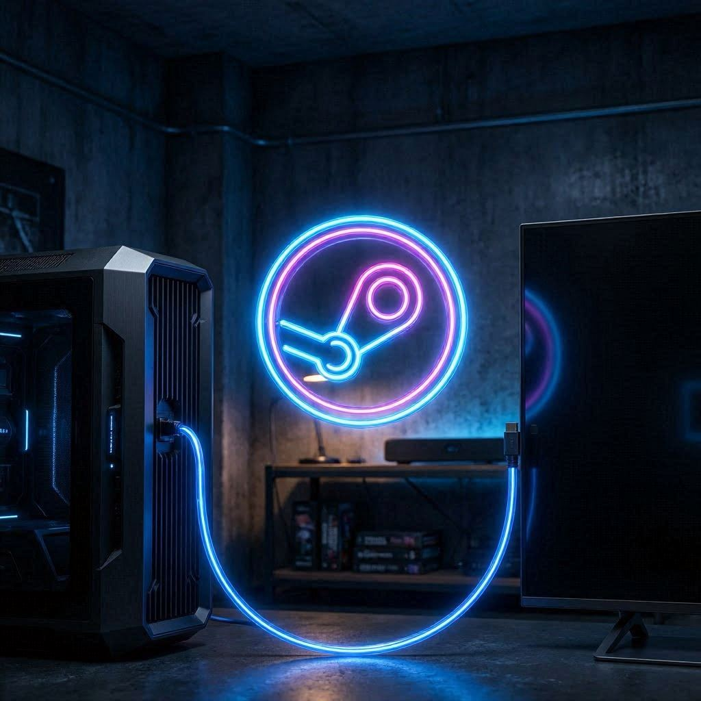
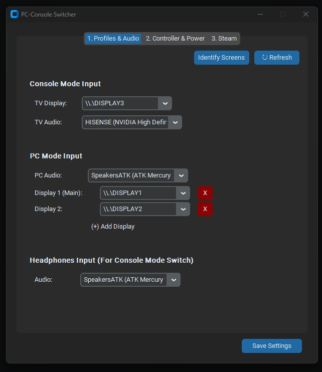
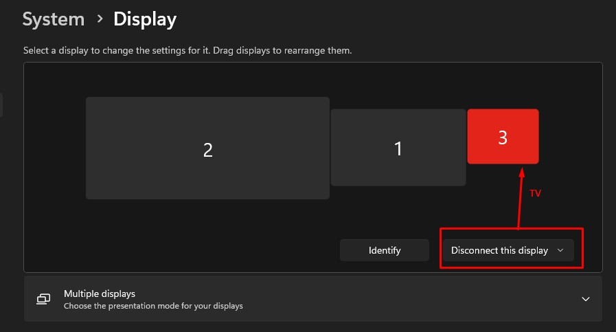
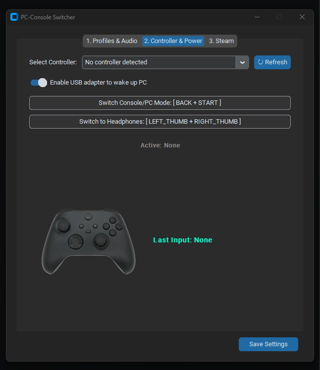
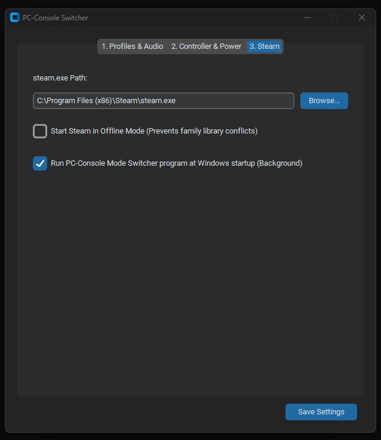

==============PC-Console Switcher==============

A lightweight, automated utility to seamlessly switch your Windows environment between "Desktop PC Mode" (multiple monitors) and "Console Mode" (TV with Big Picture).

==============Features==============

Seamless Switching: Toggle between PC and TV setups with a single custom controller shortcut.

Audio Routing: Automatically routes audio to your TV or Headphones based on the selected mode.

Background Operation: Runs silently in the system tray.

Automatic Wake-up: Configures your controller's USB adapter to wake the PC from sleep.

Persistence: Remembers your display configuration even when devices are disconnected.

==============Setup Instructions==============
1. Initial Configuration (Crucial)
To ensure the system works correctly, follow these steps to "teach" Windows your desired display states:

Connect all hardware: Ensure your TV and all PC monitors are plugged in and recognized by Windows in "Extend" mode.

Configure in App: Open the PC-Console Switcher, navigate to the Profiles & Audio tab, and select your TV display and audio devices from the dropdown menus.

Save: Click "Save Settings".

The "Ideal Scenario" Setup: Once configured, navigate to Windows Settings > System > Display. Select your TV and choose "Disconnect this display".

Why? By doing this, Windows saves this state in the registry. When the app sends the /extend command, Windows will remember to keep the TV disconnected while your PC monitors are active, preventing the PC from sending a signal to a display that isn't in use.

2. Controller Mapping
Go to the Controller & Power tab.

Select your active controller from the list.

Steam Controller (2026) is supported over USB, Bluetooth, and the Steam Controller Puck. The app uses Steam's SDL3 gamepad backend for HID controllers and falls back to XInput for Xbox-compatible controllers. Steam must be installed and its `SDL3.dll` must be next to `steam.exe` (the standard Steam installation already includes it).

Click "Switch Console/PC Mode" and hold the button combination you want to use (e.g., BACK + START). The app will capture the combo automatically.

Repeat for the "Switch to Headphones" shortcut.

Click "Save Settings".

3. Running in Background
The application starts and minimizes to the System Tray (near the Windows clock).

To restore the interface, right-click the icon in the tray and select "Show Interface".

To exit, select "Exit" from the tray menu.

4. Windows Startup
Enable the "Run at Windows startup" checkbox in the Steam tab to ensure your switcher is always active and ready to handle your controller wake-up signals.

The startup entry launches the application with `--minimized`, so Windows login shows only the PC-Console Switcher icon in the notification area. Opening `main.exe` manually still opens the normal interface.

==============Controller Troubleshooting==============

The Controller & Power tab shows the active input backend and the selected controller's VID/PID. For the Steam Controller Puck, the expected hardware ID is `VID_28DE PID_1304`.

If the controller is not listed:

1. Confirm Steam can see the paired controller and click `Refresh` in the app.
2. Confirm the configured `steam.exe` path is correct; the app loads `SDL3.dll` from the same folder.
3. Check `app_debug.log` next to the application. A successful connection contains `Controller backend: SDL3` and `Controller connected: Steam Controller`.

The old XInput-only implementation could not detect the Steam Controller because its puck is a Valve HID device rather than an XInput device.

